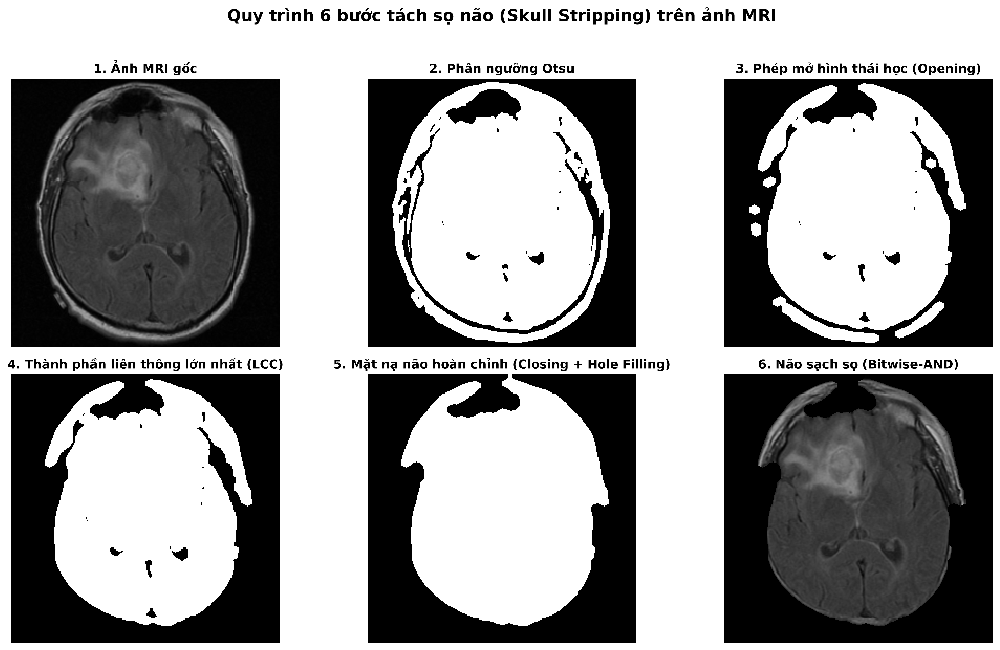

<div align="center">

# Brain Tumor MRI Segmentation & Quantitative Analysis Pipeline

### Đề tài: Phân đoạn và phát hiện tổn thương trên ảnh y tế
**Trọng tâm nghiên cứu:** Phân đoạn và định lượng khối u não trên ảnh cộng hưởng từ MRI chuỗi xung FLAIR (TCGA-LGG Benchmark)

[](https://www.python.org/)
[](LICENSE)
[-brightgreen.svg?logo=pytest&logoColor=white)](tests/)
[](https://opencv.org/)
[](https://streamlit.io/)
[-blueviolet.svg)](https://wiki.cancerimagingarchive.net/display/Public/TCGA-LGG)
[](docs/BENCHMARK_RESULTS.csv)
[](https://huit.edu.vn/)

<br/>

<p align="center">
  
</p>
<p align="center">
  <em>Hình 1: Trực quan hóa Quad View chẩn đoán khép kín từ Ảnh gốc FLAIR → Tách sọ não → Phân đoạn ổ u → Định vị cảnh báo Bounding Box đỏ kèm thông số hình học lâm sàng.</em>
</p>

</div>

---

## Mục lục điều hướng (Table of Contents)
- [📖 Cẩm nang Hướng dẫn Sử dụng Chi tiết (Full User Guide)](docs/HUONG_DAN_SU_DUNG.md)
- [📑 Tóm tắt Toàn diện Tiến trình Dự án (Project Executive Summary)](docs/TOM_TAT_TONG_QUAN_DU_AN.md)
- [🌊 Giải thích Chi tiết Mã nguồn Watershed (Code Deep Dive)](docs/GIAI_THICH_WATERSHED.md)
- [🔬 Giải thích Chi tiết Mã nguồn Region Growing (Code Deep Dive)](docs/GIAI_THICH_REGION_GROWING.md)
- [1. Giới thiệu & Động lực nghiên cứu (Overview & Motivation)](#1-giới-thiệu--động-lực-nghiên-cứu)
- [2. Tính năng Nổi bật (Key Features)](#2-tính-năng-nổi-bật)
- [3. Kiến trúc Pipeline 4 Tầng (System Architecture)](#3-kiến-trúc-pipeline-4-tầng)
- [4. Quy trình Tách sọ Não 6 Bước (6-Stage Skull Stripping)](#4-quy-trình-tách-sọ-não-6-bước-skull-stripping)
- [5. Tập Dữ liệu & Kết quả Benchmark (Dataset & Benchmarks)](#5-tập-dữ-liệu--kết-quả-thực-nghiệm-định-lượng)
- [6. Hướng dẫn Cài đặt & Khởi chạy (Quickstart)](#6-hướng-dẫn-cài-đặt--khởi-chạy-quickstart)
- [7. Hướng dẫn Lập trình Python API (Python API Usage)](#7-hướng-dẫn-sử-dụng-python-api)
- [8. Giao diện Web Chẩn đoán Streamlit (Web App Demo)](#8-giao-diện-web-chẩn-đoán-streamlit)
- [9. Cấu trúc Thư mục Dự án (Repository Structure)](#9-cấu-trúc-thư-mục-dự-án)
- [10. Nhóm Tác giả & Đơn vị Đào tạo (Authors & Credits)](#10-nhóm-tác-giả--đơn-vị-đào-tạo)
- [11. Trích dẫn & Giấy phép Bản quyền (Citation & License)](#11-trích-dẫn--giấy-phép-bản-quyền)

---

## 1. Giới thiệu & Động lực nghiên cứu

Chẩn đoán và khoanh vùng khối u não (Glioma, Meningioma, Pituitary) từ ảnh chụp cộng hưởng từ (MRI) là bài toán then chốt trong hỗ trợ phẫu thuật và xạ trị thần kinh. Trong môi trường lâm sàng thực tế, việc khoanh vùng thủ công phụ thuộc lớn vào kinh nghiệm chủ quan của bác sĩ chuyên khoa và tốn nhiều thời gian.

Dự án này phát triển một hệ thống mã nguồn mở hoàn chỉnh nhằm **tự động tách sọ não, phân đoạn khối u và trích xuất đặc trưng hình học lâm sàng** trên chuỗi xung MRI FLAIR (Fluid-Attenuated Inversion Recovery). Hệ thống giải quyết bài toán bằng cách vận dụng chuyên sâu các giải thuật **Xử lý Ảnh số Cổ điển (Classical Digital Image Processing - DIP)** kết hợp hình thái học toán học và phân thủy có hạt giống kiểm soát.

### So sánh Xử lý Ảnh số Cổ điển và Deep Learning

| Tiêu chí so sánh | Mạng nơ-ron sâu (Deep Learning: UNet, nnU-Net...) | Pipeline Xử lý Ảnh số Cổ điển (Dự án này) |
| :--- | :--- | :--- |
| **Hạ tầng phần cứng** | Đòi hỏi GPU đắt tiền ($> 8\text{ GB}$ VRAM), tiêu thụ điện năng lớn. | **Chạy mượt mà trên CPU thông thường** (chỉ cần 4 GB RAM). |
| **Tốc độ xử lý (Latency)** | Thường dao động 50 – 200 ms / lát cắt (phụ thuộc batching). | **Siêu tốc: ~6.13 ms / lát cắt** (khả thi xử lý thời gian thực). |
| **Tính minh bạch (Explainability)** | Mô hình "Hộp đen" (Black-box), khó kiểm chứng logic sai sót. | **Minh bạch 100% toán học** (dựa trên giải tích gradient và hình thái học). |
| **Chống dương tính giả** | Dễ nhầm lẫn tín hiệu xương sọ và da đầu nếu ít dữ liệu. | **Độ đặc hiệu 99.04%** trên não lành nhờ Tách sọ 6 bước & Anomaly Gate. |
| **Khả năng triển khai** | Khó khăn khi đóng gói lên các thiết bị y tế nhúng (Edge AI). | **Dễ dàng tích hợp vào trạm máy trạm lâm sàng hoặc xe khám lưu động.** |

---

## 2. Tính năng Nổi bật

- **Tách sọ Não 6 Bước (Skull Stripping Pipeline):** Loại bỏ triệt để xương sọ, mô mềm ngoài da đầu và nền đen bằng phân ngưỡng Otsu, phép mở $5 \times 5$, trích xuất thành phần liên thông lớn nhất (LCC) và phép đóng lấp đầy khoang nội sọ.
- **Động cơ Phân đoạn Đối chứng Kép (Dual-Method Engine):**
  - **Marker-controlled Watershed (Baseline chính):** Khai thác biến đổi khoảng cách Euclidean Distance Transform (EDT) sinh mầm hạt giống tại cực đại khoảng cách, triệt tiêu hoàn toàn hiện tượng quá phân đoạn (over-segmentation).
  - **Seeded Region Growing (Đối chứng):** Tự động phát hiện hạt giống cường độ cực đại trong nhu mô não đã bóc sọ, lan truyền 8 láng giềng theo hàng đợi BFS với ngưỡng dung sai cường độ động.
- **Cổng Sàng lọc Lâm sàng (Clinical Anomaly Gate):** Ứng dụng kiểm định thống kê Z-score trên phân bố cường độ nhu mô não, tự động kết luận lát cắt không có u nếu không phát hiện tổn thương tăng quang bất thường ($z_{\text{max}} < 2.3$).
- **Trích xuất Đặc trưng Hình học Y sinh:**
  - Diện tích khối u ($S_{\text{tumor}}$ theo pixels và mm²).
  - Tỷ lệ phần trăm u chiếm dụng thể tích não ($R = \frac{S_{\text{tumor}}}{S_{\text{brain}}} \times 100\%$).
  - Chỉ số độ tròn bờ viền Circularity Index ($C = \frac{4\pi \cdot \text{Area}}{\text{Perimeter}^2}$), hỗ trợ phân biệt bờ u tròn đều (lành tính) và bờ u gồ ghề/xâm lấn (ác tính).
- **Bộ đo Đánh giá Chuẩn Y tế Quốc tế:** Cung cấp đầy đủ chỉ số đối chứng Ground Truth: Dice Similarity Coefficient ($F_1$), IoU (Jaccard Index), Độ nhạy (Sensitivity/Recall), Độ đặc hiệu (Specificity).
- **Ứng dụng Web Tương tác (Streamlit):** Hỗ trợ đầy đủ Dark/Light mode, Dual-mode (Chẩn đoán lát cắt đơn lẻ & Khám phá dữ liệu hàng loạt trên 3.929 lát cắt).

---

## 3. Kiến trúc Pipeline 4 Tầng

Quy trình xử lý ảnh khép kín từ dữ liệu đầu vào đến kết quả đo lường và cảnh báo lâm sàng:

```
[Ảnh MRI Sọ Não Gốc (FLAIR / T1-CE)]
               │
               ▼
1. 【TIỀN XỬ LÝ (PREPROCESSING)】
   ├── Chuẩn hóa kích thước không gian (256x256) & dải giá trị mức xám [0, 255]
   ├── Lọc song phương Bilateral Filter khử nhiễu Rician nhưng bảo toàn đường biên u
   └── Tăng cường tương phản cục bộ bằng CLAHE (Clip Limit = 2.0, Grid = 8x8)
               │
               ▼
2. 【TÁCH SỌ NÃO (SKULL STRIPPING)】
   ├── Phân ngưỡng Otsu toàn cục tìm vùng mô đầu
   ├── Phép mở hình thái học (Opening 5x5) cắt đứt cầu nối mô giữa màng não và xương sọ
   ├── Trích xuất thành phần liên thông lớn nhất (Largest Connected Component - LCC)
   ├── Phép đóng hình thái học (Closing & Hole Filling) lấp đầy khoang nội sọ
   └── Nhân chập mặt nạ sinh ảnh nhu mô não đã bóc sọ (Stripped Brain)
               │
               ▼
3. 【CỔNG KIỂM ĐỊNH LÂM SÀNG & PHÂN ĐOẠN Ổ U (SEGMENTATION)】
   ├── Cổng Clinical Anomaly Gate: Kiểm tra Z-score cường độ cực đại trong khoang não
   ├── Tuyến A (Baseline): Marker-controlled Watershed (Biến đổi khoảng cách EDT + Hạt giống)
   └── Tuyến B (Đối chứng): Seeded Region Growing (Lan truyền 8 láng giềng từ cực đại cường độ)
               │
               ▼
4. 【TRÍCH XUẤT ĐẶC TRƯNG & CẢNH BÁO LÂM SÀNG】
   ├── Định vị đường bao Contour, tính Bounding Box màu đỏ cảnh báo quanh ổ u
   ├── Đo lường hình học y sinh: Diện tích u (px, mm²), Tỷ lệ u/não (%), Độ tròn bờ u Circularity
   └── Lớp phủ Overlay màu RGBA & Kết xuất lưới ảnh trực quan Quad View (2x2)
```

---

## 4. Quy trình Tách sọ Não 6 Bước (Skull Stripping)

Bước tách sọ não đóng vai trò sống còn trong xử lý ảnh y tế để loại bỏ nguy cơ bắt nhầm tín hiệu xương sọ và da đầu có mức xám tương tự mô u:

<p align="center">
  
</p>
<p align="center">
  <em>Hình 2: Trực quan hóa 6 bước trong quy trình Tách sọ não Skull Stripping trên ảnh MRI sọ não lát cắt thực tế.</em>
</p>

1. **Original Image:** Ảnh MRI gốc chuỗi xung FLAIR chứa đầy đủ cấu trúc xương sọ và da đầu.
2. **Otsu Thresholding:** Phân ngưỡng nhị phân tự động phân tách phần đầu khỏi phông nền đen.
3. **Morphological Opening ($5 \times 5$):** Áp dụng phép mở $A \circ B = (A \ominus B) \oplus B$ với phần tử cấu trúc elip nhằm triệt tiêu các cầu nối mô mỏng manh nối giữa xương sọ và nhu mô não.
4. **Largest Connected Component (LCC):** Gán nhãn các thành phần liên thông và chỉ giữ lại thành phần có diện tích cực đại (đại diện cho nhu mô não).
5. **Morphological Closing:** Áp dụng phép đóng $A \bullet B = (A \oplus B) \ominus B$ kết hợp thuật toán lấp lỗ hổng (Hole Filling) để phục hồi trọn vẹn các rãnh não và não thất.
6. **Stripped Brain:** Nhân mặt nạ nhị phân với ảnh gốc ($I_{\text{stripped}} = I \odot M_{\text{brain}}$) tạo ra ảnh não sạch sọ hoàn hảo.

---

## 5. Tập Dữ liệu & Kết quả Thực nghiệm Định lượng

Dự án sử dụng bộ dữ liệu chuẩn y sinh quốc tế **TCGA-LGG (The Cancer Genome Atlas Low-Grade Glioma)** được công bố bởi Buda et al. (2019) trên tạp chí *Computers in Biology and Medicine*:
- **Quy mô:** Bao gồm **3.929 lát cắt MRI** (kích thước $256 \times 256$ pixel) thu thập từ **110 bệnh nhân** mắc u tế bào đệm cấp độ thấp.
- **Phân tầng dữ liệu:**
  - **1.373 lát cắt bệnh lý** có chứa khối u não (đi kèm mặt nạ Ground Truth do chuyên gia thần kinh khoanh vùng).
  - **2.556 lát cắt não lành** không chứa tổn thương (dùng để kiểm thử tỷ lệ dương tính giả).

### Bảng đối chiếu định lượng trên toàn bộ 3.929 lát cắt (Mean ± Std)

| Tập dữ liệu kiểm thử | Phương pháp | Dice Score ($F_1$) | IoU (Jaccard) | Độ nhạy (Sensitivity) | Độ đặc hiệu (Specificity) | Tốc độ xử lý (ms/ảnh) |
| :--- | :--- | :---: | :---: | :---: | :---: | :---: |
| **Lát có u (1.373 lát)** | **Marker Watershed** | **0.4446 ± 0.3014** | **0.3368 ± 0.2677** | **0.4436 ± 0.3170** | **0.9915 ± 0.0107** | **6.13 ± 3.32 ms** |
| | Region Growing | 0.1990 ± 0.2682 | 0.1416 ± 0.2119 | 0.2226 ± 0.3221 | 0.9851 ± 0.0432 | 12.13 ± 22.83 ms |
| **Lát não lành (2.556 lát)** | **Marker Watershed** | N/A (Không u) | N/A | N/A | **0.9904 ± 0.0100** | **6.15 ± 3.40 ms** |
| | Region Growing | N/A (Không u) | N/A | N/A | 0.9760 ± 0.0480 | 12.05 ± 21.50 ms |

<br/>

<table align="center">
  <tr>
    <td align="center">
      <br/>
      <em>Hình 3: Biểu đồ cột đối chiếu 4 chỉ số y sinh trên 3.929 lát cắt.</em>
    </td>
    <td align="center">
      <br/>
      <em>Hình 4: Khảo sát độ nhạy siêu tham số EDT ratio của Watershed.</em>
    </td>
  </tr>
</table>

### Nhận xét thực nghiệm chuyên sâu:
1. **Watershed vượt trội toàn diện:** Nhờ cơ chế neo mầm hạt giống tại đỉnh khoảng cách Euclidean (EDT), Marker-controlled Watershed đạt chỉ số Dice trung bình **0.4446** (gấp **2.23 lần** so với Region Growing: 0.1990), đồng thời tốc độ thực thi ổn định gấp đôi (~6.13 ms so với ~12.13 ms).
2. **Khả năng triệt tiêu dương tính giả xuất sắc:** Đạt độ đặc hiệu **99.04%** trên 2.556 lát cắt não lành, chứng minh tính hiệu quả vượt bậc của bước tách sọ não và cổng sàng lọc Anomaly Gate.
3. **Phân tích ca thất bại (Failure Cases):** Khối u kích thước cực nhỏ ($< 1.5\%$ diện tích não) hoặc có bờ viền mờ nhạt sát não thất là thách thức lớn đối với Region Growing (dễ bị tràn viền hoặc lệch hạt giống). Watershed khắc phục tốt hơn nhưng vẫn chịu suy giảm nhẹ nếu gradient biên quá yếu.

---

## 6. Hướng dẫn Cài đặt & Khởi chạy (Quickstart)

> [!TIP]
> 📖 **Cẩm nang vận hành đầy đủ:** Quý Thầy/Cô và người dùng có thể tham khảo tài liệu chi tiết tại **[docs/HUONG_DAN_SU_DUNG.md](docs/HUONG_DAN_SU_DUNG.md)** bao gồm **Kịch bản nghiệm thu nhanh 5 phút**, hướng dẫn chi tiết từng nút bấm trên trạm Streamlit PACS, giải thích chỉ số y sinh và xử lý sự cố.

### 6.1. Yêu cầu Hệ thống
- **Hệ điều hành:** Windows 10/11, macOS, hoặc Linux Ubuntu 20.04+.
- **Python:** Phiên bản **3.10** trở lên.
- **Phần cứng:** Tối thiểu 4 GB RAM (không yêu cầu GPU).

### 6.2. Cài đặt Môi trường trong 3 bước
```bash
# Bước 1: Clone repository về máy
git clone https://github.com/mtzwyu/brain-tumor-mri-segmentation.git
cd brain-tumor-mri-segmentation

# Bước 2: Tạo và kích hoạt môi trường ảo Python
python -m venv venv
# Trên Windows:
.\venv\Scripts\activate
# Trên Linux/macOS:
source venv/bin/activate

# Bước 3: Cài đặt các thư viện phụ thuộc
pip install -r requirements.txt
```

### 6.3. Tải bộ dữ liệu đầy đủ TCGA-LGG (3.929 lát cắt)
```bash
python scripts/download_full_dataset.py
```
*Script tự động tải từ kho Hugging Face và giải nén đầy đủ vào `data/full/` trong ~1-2 phút.*

### 6.4. Khởi chạy Ứng dụng Web Demo Streamlit
```bash
streamlit run demo/app.py
```
*Truy cập trình duyệt tại địa chỉ: `http://localhost:8501`.*

### 6.5. Chạy Benchmark Đa tiến trình Toàn bộ Dữ liệu
```bash
python scripts/run_all_experiments.py
```
*Tự động quét và đánh giá toàn bộ 3.929 lát cắt chỉ trong **~20 - 25 giây**, xuất kết quả ra `docs/BENCHMARK_RESULTS.csv`.*

### 6.6. Chạy Bộ Kiểm thử Tự động (Unit Tests)
```bash
pytest -v
```
*Toàn bộ 27 bài test bao quát các ca biên, kiểm tra bất biến DIP và đo lường y sinh phải vượt qua 100%.*

---

## 7. Hướng dẫn Sử dụng Python API

Bạn có thể dễ dàng nhúng module điều phối `BrainTumorPipeline` vào ứng dụng hoặc nghiên cứu của riêng mình chỉ với vài dòng mã:

```python
import cv2
from src.pipeline import BrainTumorPipeline

# 1. Khởi tạo pipeline với giải thuật mong muốn ('watershed' hoặc 'region_growing')
pipeline = BrainTumorPipeline(
    method="watershed",
    params={"dist_thresh_ratio": 0.4, "enable_presence_gate": True}
)

# 2. Đọc ảnh MRI sọ não (Grayscale uint8)
image = cv2.imread("data/full/images/TCGA_CS_4941_19960909_13.png", cv2.IMREAD_GRAYSCALE)

# 3. Thực thi pipeline khép kín
result, intermediates = pipeline.process(image)

# 4. Trích xuất các thông số chẩn đoán lâm sàng
if result.tumor_detected:
    print("Phat hien khoi u nao (Tumor Detected)!")
    print(f"  - Toa do Bounding Box (x, y, w, h): {result.bbox}")
    print(f"  - Dien tich u: {result.tumor_area_px} pixels ({result.tumor_ratio_percent:.2f}% dien tich nao)")
    print(f"  - Do tron bo vien (Circularity): {result.circularity:.4f}")
else:
    print("Lat cat nhu mo nao lanh tinh (Khong phat hien khoi u).")

# 5. Lưu ảnh trực quan hóa Quad View (2x2)
cv2.imwrite("output_quad_view.png", intermediates["quad"])
```

---

## 8. Giao diện Web Chẩn đoán Streamlit

Ứng dụng Web Demo cung cấp giải pháp trực quan hóa lâm sàng tương tác cao:

- **Chế độ Chẩn đoán Lát cắt Đơn lẻ (Single Slice Inspection):**
  - Tải ảnh MRI tùy ý (JPG, PNG) hoặc chọn ngẫu nhiên từ kho 3.929 lát cắt TCGA-LGG.
  - Chuyển đổi linh hoạt giữa 2 giải thuật Watershed và Region Growing.
  - Tinh chỉnh tương tác các siêu tham số lọc nhiễu, tỷ lệ ngưỡng khoảng cách EDT và dung sai cường độ.
  - Hiển thị chi tiết 8 bước ảnh trung gian phục vụ giải thích cơ chế (Explainability).
- **Chế độ Khám phá Benchmark Hàng loạt (Batch Benchmark Explorer):**
  - Xem danh mục ca bệnh phân tầng: U điển hình, U nhỏ ($< 1.5\%$), U bờ mờ nhạt, Não lành tính.
  - Xem trực tiếp ma trận tương đồng Dice / IoU và biểu đồ phân tán hiệu năng.
- **Tối ưu trải nghiệm người dùng:** Tự động thích ứng hoàn hảo trên cả giao diện Sáng và Tối (Light & Dark theme).

---

## 9. Cấu trúc Thư mục Dự án

```
brain-tumor-mri-segmentation/
├── configs/                        # Cấu hình tham số hệ thống
│   └── default_params.yaml         # Siêu tham số lọc nhiễu, tách sọ và phân đoạn
├── data/                           # Dữ liệu ảnh MRI
│   ├── README.md                   # Mô tả quy cách cấu trúc ảnh và nhãn
│   └── full/                       # Toàn bộ 3.929 lát cắt chuẩn TCGA-LGG
│       ├── images/                 # Ảnh MRI chuỗi xung FLAIR (256x256, PNG)
│       ├── masks/                  # Mặt nạ Ground Truth (256x256, PNG nhị phân)
│       └── metadata.csv            # Bảng thông tin 110 bệnh nhân và 3.929 lát cắt
├── demo/                           # Giao diện Web tương tác Streamlit
│   ├── app.py                      # Mã nguồn chính giao diện chẩn đoán trực quan (Dual-mode)
│   └── utils.py                    # Tiện ích nạp ảnh, tạo ảnh trung gian và xuất file
├── docs/                           # Báo cáo đồ án toàn văn và tài liệu kỹ thuật
│   ├── HUONG_DAN_SU_DUNG.md        # Cẩm nang hướng dẫn sử dụng & kịch bản nghiệm thu 5 phút
│   ├── BAO_CAO_DO_AN_XLAS.docx     # Báo cáo tổng kết đồ án toàn văn Microsoft Word (chuẩn HUIT)
│   ├── BAO_CAO_DO_AN_XLAS.md       # Toàn văn báo cáo đồ án định dạng Markdown
│   ├── BENCHMARK_RESULTS.csv       # Tổng hợp định lượng theo lát u và não lành
│   ├── BENCHMARK_RESULTS_FULL.csv  # Chi tiết 7.858 kết quả đo đạc từng ảnh
│   ├── DATA_EXPLORATION_REPORT.md  # Báo cáo thống kê phân bố dữ liệu TCGA-LGG
│   ├── KHUNG_NOI_DUNG_TONG_QUAT_DO_AN_XLAS.md # Đề cương chi tiết 8 chương đồ án
│   ├── QUY_CHUAN_DINH_DANG_BAO_CAO_WORD.md   # Quy chuẩn định dạng văn bản Word HUIT
│   └── SPEC_PIPELINE_MRI.md        # Đặc tả toán học và giao diện lập trình pipeline
├── notebooks/                      # Jupyter Notebooks thực nghiệm trực quan
│   ├── 01_data_exploration.ipynb   # Thống kê, phân tích phân bố dữ liệu
│   ├── 02_preprocessing_and_skull_stripping.ipynb # Khử nhiễu và tách sọ não 6 bước
│   ├── 03_tumor_segmentation_comparison.ipynb     # So sánh Watershed vs. Region Growing
│   └── 04_quantitative_evaluation.ipynb           # Đánh giá định lượng toàn diện
├── reports/                        # Báo cáo xuất bản, slide và đồ thị
│   ├── SLIDE_THUYET_TRINH_XLAS.pptx # 20 slide bài giảng/thuyết trình bảo vệ đồ án (PowerPoint)
│   ├── SLIDE_THUYET_TRINH_XLAS.pdf  # 20 slide bài giảng/thuyết trình định dạng PDF
│   ├── figures/                    # Biểu đồ nghiên cứu và minh họa quy trình (DPI 300)
│   └── notebooks/                  # Báo cáo HTML kết xuất từ 4 Jupyter Notebooks
├── scripts/                        # Scripts tự động hóa và tiện ích tinh gọn
│   ├── analyze_watershed_sensitivity.py # Phân tích độ nhạy siêu tham số Watershed
│   ├── download_full_dataset.py    # Tải 3.929 ảnh TCGA-LGG từ Hugging Face
│   ├── export_demo_quad.py         # Kết xuất ảnh Quad View chẩn đoán (Hình 7.1)
│   ├── export_skull_stripping_figure.py # Xuất hình minh họa 6 bước bóc sọ (Hình 4.1)
│   └── run_all_experiments.py      # Benchmark đa tiến trình 3.929 lát cắt
├── src/                            # Mã nguồn module xử lý ảnh số lõi
│   ├── __init__.py
│   ├── pipeline.py                 # Bộ điều phối toàn trình BrainTumorPipeline
│   ├── preprocessing/              # Tiền xử lý & Tách sọ
│   │   ├── filters.py              # Lọc Bilateral và cân bằng CLAHE
│   │   └── skull_strip.py          # Bóc sọ 6 bước dựa trên hình thái học
│   ├── segmentation/               # Giải thuật phân đoạn u
│   │   ├── base.py                 # Lớp cơ sở trừu tượng BaseSegmenter
│   │   ├── watershed.py            # Marker-controlled Watershed
│   │   └── region_growing.py       # Seeded Region Growing
│   ├── measurement/                # Đo lường đặc trưng hình học
│   │   ├── features.py             # Diện tích, Circularity, Bounding Box
│   │   └── visualization.py        # Tạo ảnh lớp phủ Overlay và Quad View
│   ├── evaluation/                 # Đo lường chỉ số đánh giá y sinh
│   │   ├── metrics.py              # Dice, IoU, Sensitivity, Specificity
│   │   └── benchmark.py            # Đánh giá hàng loạt đa tiến trình
│   └── report/                     # Trình tạo văn bản báo cáo
│       └── docx_builder.py         # Bộ dựng báo cáo Word tuân thủ quy chuẩn HUIT
├── tests/                          # Bộ kiểm thử tự động (27 bài test)
│   ├── conftest.py                 # Fixtures dữ liệu ảnh mẫu và mặt nạ giả lập
│   ├── test_measurement.py         # Kiểm thử đo đạc đặc trưng hình học và lớp phủ
│   ├── test_metrics.py             # Kiểm thử độ chính xác các hàm đánh giá y sinh
│   ├── test_pipeline.py            # Kiểm thử bộ điều phối BrainTumorPipeline toàn trình
│   ├── test_preprocessing.py       # Kiểm thử lọc nhiễu và bóc sọ não
│   └── test_segmentation.py        # Kiểm thử các giải thuật phân đoạn
├── .gitignore                      # Loại trừ dữ liệu nặng và cache môi trường
├── LICENSE                         # Giấy phép bản quyền MIT
├── requirements.txt                # Danh sách thư viện phụ thuộc
└── README.md                       # Tài liệu tổng quan dự án
```

---

## 10. Nhóm Tác giả & Đơn vị Đào tạo

### Nhóm Sinh viên Thực hiện:
- **Hà Mạnh Trường**
- **Huỳnh Tâm Trí**

### Đơn vị Đào tạo & Quản lý Học phần:
- **Trường Đại học Công Thương TP. Hồ Chí Minh (HUIT)**
- **Khoa:** Công nghệ Thông tin
- **Bộ môn:** Xử lý ảnh số
- **Học phần:** Đồ án Xử lý ảnh số (Năm học 2026–2027)

---

## 11. Trích dẫn & Giấy phép Bản quyền

### Trích dẫn Nguồn Dữ liệu (Citation)
Nếu bạn sử dụng bộ dữ liệu hoặc mã nguồn của dự án này trong các nghiên cứu khoa học, vui lòng trích dẫn công trình gốc của nhóm tác giả Buda et al.:

```bibtex
@article{buda2019association,
  title={Association of genomic subtypes of lower-grade gliomas with shape features automatically extracted by a deep learning algorithm},
  author={Buda, Mateusz and Saha, Ashirbani and Mazurowski, Maciej A},
  journal={Computers in Biology and Medicine},
  volume={109},
  pages={218--225},
  year={2019},
  publisher={Elsevier}
}
```

### Giấy phép Bản quyền (License)
Dự án được phân phối mã nguồn mở theo các điều khoản của **[MIT License](LICENSE)**. Toàn bộ sinh viên, giảng viên và nhà nghiên cứu y sinh có thể tự do tham khảo, tái sử dụng và phát triển mở rộng cho các mục đích học tập và nghiên cứu phi thương mại.
